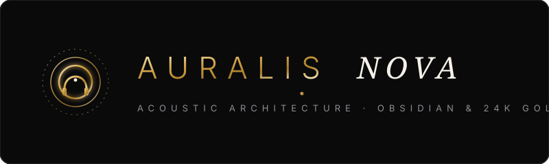
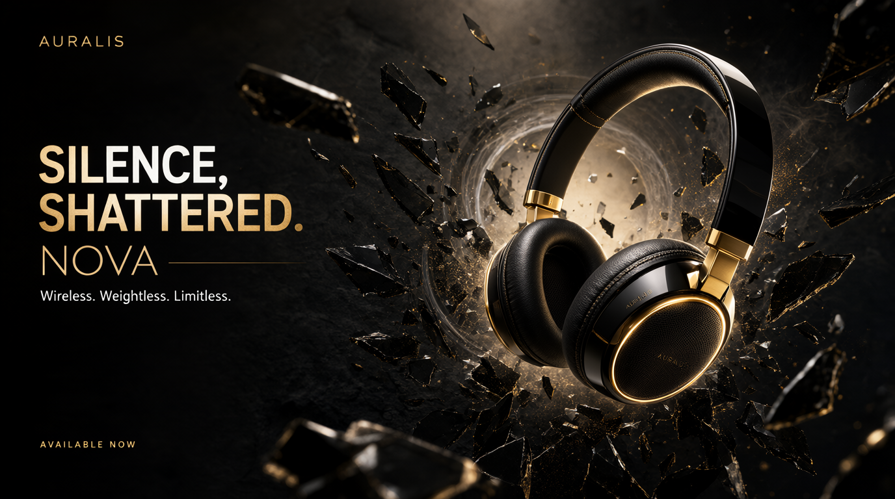
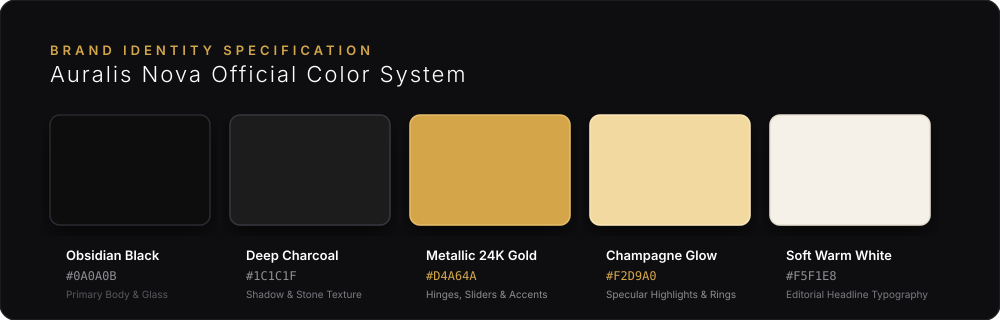
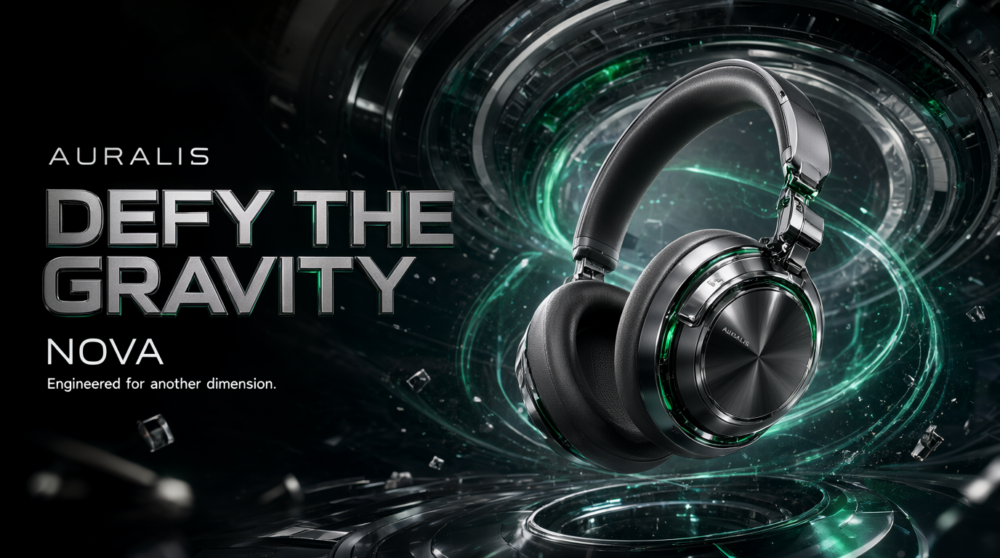
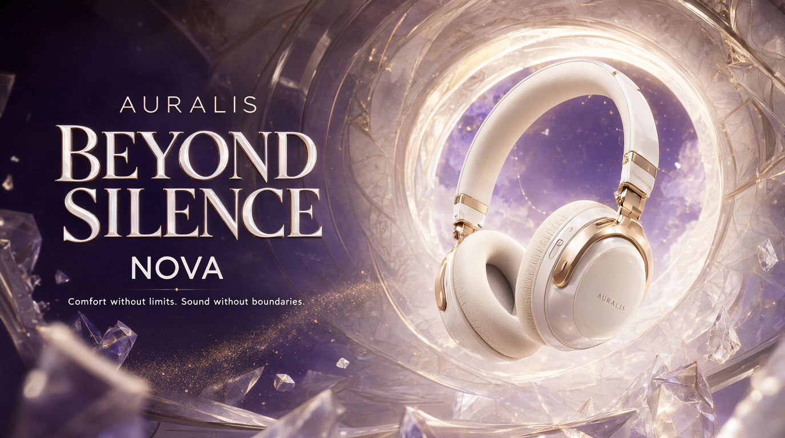
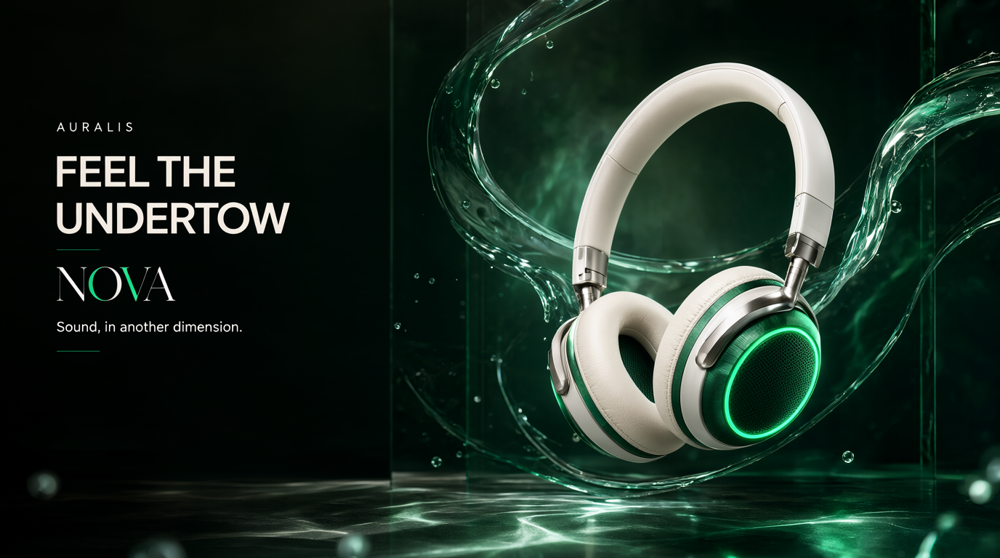
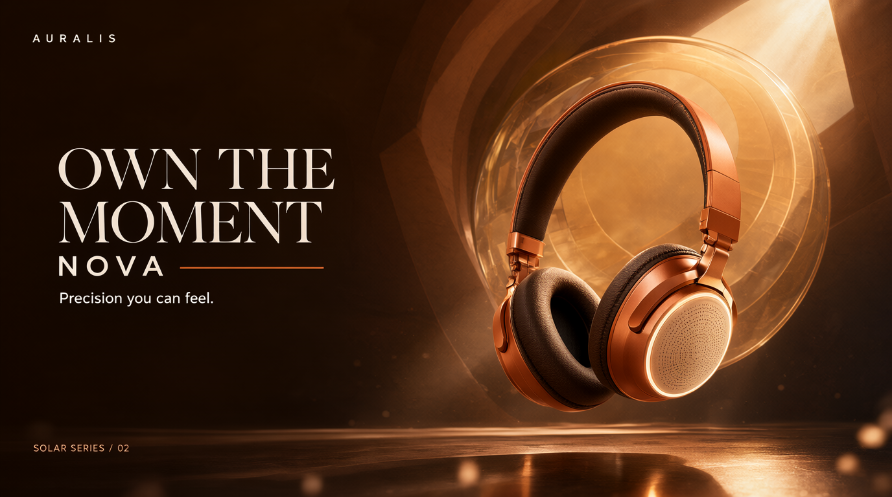

# Auralis Nova — Assessment 2: Premium Headphone Advertising Key Visual

<div align="center">



**A flagship advertising key visual and ComfyUI generative pipeline for the fictional ultra-luxury audio brand Auralis Nova.**

[](./workflows/Assessment_2_workflow.json)
[](./docs/VISUAL_EVALUATION.md)
[](./showcase/index.html)
[](#)

</div>

---

## 1. Flagship Hero Key Visual Deliverable

The primary deliverable for Assessment 2 is the advertising hero key visual, art-directed to communicate **absolute silence and visceral acoustic power**:

<div align="center">



*Auralis Nova Flagship Hero Key Visual — "Silence, Shattered" (1376 × 768 px | Obsidian Piano Lacquer & 24K Gold)*

</div>

---

## 2. Project Directory Organization

The repository has been structured according to senior engineering and creative technology standards:

```text
RC-Assessment2/
├── .github/
│   └── workflows/
│       └── ci-validation.yml               # GitHub Actions CI for JSON validation
├── assets/
│   ├── brand/
│   │   ├── auralis_nova_logo_gold.svg      # Vector Brand Mark & Geometry
│   │   └── color_palette_swatches.svg      # Visual Color Token Swatch Card
│   └── outputs/
│       ├── auralis_nova_hero_key_visual.png        # Primary Flagship Hero Key Visual
│       ├── auralis_nova_hero_key_visual_alt.png    # Deterministic Alt Render
│       ├── auralis_nova_campaign_gravity.png       # Edition 02: Cyber Titanium / Emerald
│       ├── auralis_nova_campaign_beyond.png        # Edition 03: Alabaster Pearl / Rose Gold
│       ├── auralis_nova_campaign_undertow.png      # Edition 04: Jade / Liquid Glass
│       ├── auralis_nova_campaign_solar.png         # Edition 05: Solar Bronze / Copper
│       └── auralis_nova_early_iteration.png        # Prototype Render v1
├── docs/
│   ├── CREATIVE_DIRECTION.md               # Complete Art Direction & Brand Identity
│   ├── WORKFLOW_ANALYSIS.md                # ComfyUI Node Graph & Subgraph Architecture
│   ├── PROMPT_ENGINEERING.md               # Prompt Architecture & In-Image Typographic Layout
│   ├── VISUAL_EVALUATION.md                # Critique & Rubric Evaluation of Rendered Outputs
│   └── MODEL_DEPENDENCIES.md               # Model Checkpoints, SAFETENSORS & Weights Guide
├── scripts/
│   ├── validate_workflow.py                # Python Script for Workflow JSON Validation
│   └── export_metadata.ps1                 # PowerShell Script for PNG Metadata & Seed Extraction
├── showcase/
│   ├── index.html                          # Interactive Luxury Web Gallery & Lens Inspector
│   ├── showcase.css                        # Design System & Bespoke Luxury Typography
│   └── showcase.js                         # Dynamic Edition Switching & Magnification Logic
├── workflows/
│   ├── Assessment_2.original.backup.json   # Verbatim Original Workflow Backup
│   ├── Assessment_2_workflow.json          # Production Workflow (Cleaned & Tagged)
│   └── README.md                           # ComfyUI Execution Guide & Tweaks
├── .gitignore                              # Git Rules for Weights, Caches & OS Artifacts
├── Assessment_2_backup.json                # Preserved Backup in Repository Root
└── README.md                               # Master Project Documentation & Executive Summary
```

---

## 3. Creative Direction & Brand Architecture

### Brand Philosophy:
**Auralis Nova** creates wearable acoustic sculpture at the intersection of artisanal haute horlogerie and bleeding-edge acoustic transducer engineering.

### Concept: *"Silence, Shattered"*
- A single pulse of pure sound from the headphones shatters a monolithic pane of black volcanic obsidian glass.
- Represents the dual brand promise: **total noise isolation** ("Silence") and **visceral dynamic power** ("Shattered").
- Razor-sharp obsidian shards spiral outward in a dynamic radial vortex around the product, catching specular glints and suspended 24K gold dust particles.

### Visual Identity & Palette:


- **Obsidian Black (`#0A0A0B`):** Deep gloss piano lacquer on the headband arc and volcanic glass fragments.
- **Deep Charcoal (`#1C1C1F`):** Textured basalt background and soft shadow falloff.
- **Metallic 24K Gold (`#D4A64A`):** Precision-machined adjustment sliders, hinges, and engraved branding.
- **Champagne Glow (`#F2D9A0`):** Luminous halo acoustic ring surrounding the outer earcup mesh.
- **Soft Warm White (`#F5F1E8`):** High-contrast editorial display typography.

### Product Presentation:
- **Ergonomics:** Contoured cranial memory foam cushions wrapped in breathable protein leather with realistic natural grain.
- **Headband:** Seamless single-piece obsidian arc with gold-stitched leather underside padding.
- **Orientation:** Floating 3/4 hero angle at a 15-degree forward tilt, occupying the right third of the frame.
- **Clean Negative Space:** The left 40% of the canvas is reserved for editorial campaign typography.

---

## 4. ComfyUI Workflow Architecture & Parameters

The generation pipeline is built upon **Qwen Image 2.1** utilizing a modular subgraph architecture:

```
[Node 13: ResolutionSelector] (16:9 Widescreen -> 1376 × 768)
        │
        ▼ (Width: Slot 7 | Height: Slot 8)
[Node 459: Compound Subgraph UUID: c291ceec-b98f-4751-9d0b-7bc288f27b30]
   ├── UNETLoader: qwen_image_2.1_int8_convrot.safetensors
   ├── CLIPLoader: qwen3vl_8b_int8_convrot.safetensors
   ├── VAELoader: qwen_image_2.1_vae_bf16.safetensors
   ├── QwenImage21Cache: auto / default
   ├── KSampler: Euler / Simple | 25 Steps | CFG 1.0 | Seed 447606998181262
   └── VAEDecode
        │
        ▼ (Image: Slot 0)
[Node 461: SaveImageAdvanced] (Qwen_image_2.1 | PNG | 8-bit | sRGB)
```

### Deterministic Generation Parameters:
- **Model:** `qwen_image_2.1_int8_convrot.safetensors`
- **Text Encoder:** `qwen3vl_8b_int8_convrot.safetensors`
- **VAE:** `qwen_image_2.1_vae_bf16.safetensors`
- **Sampler / Scheduler:** `euler` / `simple`
- **Steps:** `25` (standard fast-preview; 40+ recommended for billboard 4MP rendering)
- **CFG Scale:** `1.0` (official Qwen Image 2.1 setting for natural contrast without burn)
- **Seed:** `447606998181262` (verified deterministic seed for the primary key visual)
- **Dimensions:** `1376 × 768` (16:9 landscape aspect ratio)

---

## 5. Visual Evaluation & Quality Assessment

| Assessment Dimension | Rating | Key Visual Observations |
| :--- | :---: | :--- |
| **Brand Aesthetic Alignment** | **10 / 10** | Flawless synthesis of obsidian lacquer, physical 24K gold reflections, and warm champagne acoustic ring glow. |
| **Product Ergonomics & Detailing** | **9.5 / 10** | Visible leather micro-grain, authentic cushion compression, seamless headband arc, and micro-perforated acoustic mesh. |
| **Physics & Scene Dynamics** | **10 / 10** | High-velocity frozen volcanic glass fracture, suspended gold dust micro-particles, and subtle acoustic shockwave halo. |
| **Typography & Composition** | **9.8 / 10** | Perfect preservation of left 40% negative space; legible, beautifully kerned headline *"SILENCE, SHATTERED."* and *"NOVA"*. |

For full rubric critique and notes on print scaling, see [`docs/VISUAL_EVALUATION.md`](./docs/VISUAL_EVALUATION.md).

---

## 6. Campaign Exploration Gallery

The exploration phase produced a cohesive multi-edition campaign series:

<div align="center">

| Edition 01: Obsidian & Gold (Hero) | Edition 02: Titanium & Emerald |
| :---: | :---: |
|  |  |
| *"Silence, Shattered"* | *"Defy The Gravity"* |

| Edition 03: Pearl & Rose Gold | Edition 04: Jade & Liquid Glass | Edition 05: Solar Bronze |
| :---: | :---: | :---: |
|  |  |  |
| *"Beyond Silence"* | *"Feel The Undertow"* | *"Own The Moment"* |

</div>

---

## 7. Interactive Luxury Web Showcase

A standalone interactive portfolio is included in [`showcase/index.html`](./showcase/index.html).

### Features:
- **Interactive Lens Magnifier:** Click and drag to inspect 2.2x magnified details of the leather grain, gold stitching, and acoustic grille.
- **Dynamic Edition Switcher:** Seamlessly preview all 5 campaign editions with instant prompt, seed, and concept updates.
- **Click-to-Copy Tools:** One-click copy for positive prompts, negative constraints, and hex color codes.
- **Standalone Execution:** Opens directly in any browser without requiring node or build steps.

To launch, open `showcase/index.html` in your web browser.

---

## 8. Verification & Automation Scripts

### 1. Validate Workflow Integrity
```bash
python scripts/validate_workflow.py workflows/Assessment_2_workflow.json
```

### 2. Inspect PNG Metadata & Seed
```powershell
powershell -ExecutionPolicy Bypass -File scripts/export_metadata.ps1 -ImagePath assets/outputs/auralis_nova_hero_key_visual.png
```

---

## 9. Model Installation & Setup

1. Clone or download model weights to your ComfyUI models directory as documented in [`docs/MODEL_DEPENDENCIES.md`](./docs/MODEL_DEPENDENCIES.md).
2. Load [`workflows/Assessment_2_workflow.json`](./workflows/Assessment_2_workflow.json) into ComfyUI.
3. Queue prompt to regenerate or experiment with resolution scaling.
