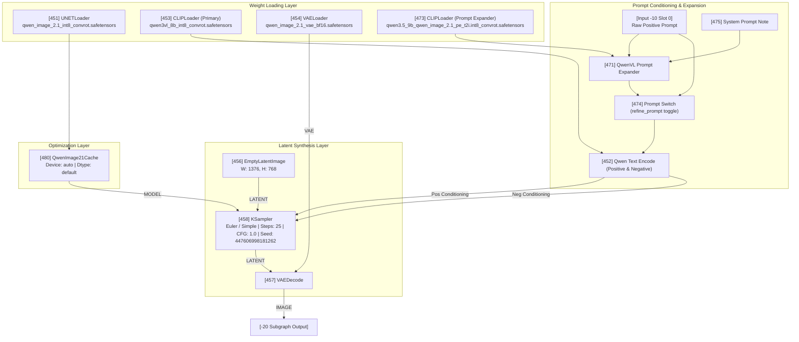

# ComfyUI Workflow Architecture & Technical Inspection

This document provides a technical audit and node-by-node architectural decomposition of the ComfyUI workflow contained in [`Assessment_2_workflow.json`](../workflows/Assessment_2_workflow.json) (original backup preserved at [`Assessment_2.original.backup.json`](../workflows/Assessment_2.original.backup.json)).

---

## 1. Top-Level Workflow Topology

The top-level graph consists of **5 main entities**:

```mermaid
graph LR
    subgraph Controls ["Input Controls"]
        N13["Node 13: ResolutionSelector<br/>16:9 Widescreen (1MP)"]
    end

    subgraph CoreEngine ["Compound Subgraph Node"]
        N459["Node 459: Qwen Image 2.1 Pipeline<br/>UUID: c291ceec-b98f-4751-9d0b-7bc288f27b30<br/>Steps: 25 | CFG: 1.0 | Euler / Simple"]
    end

    subgraph OutputSink ["Storage & Documentation"]
        N461["Node 461: SaveImageAdvanced<br/>Prefix: Qwen_image_2.1 | PNG 8-bit sRGB"]
        N463["Node 463: Note - Model Links"]
        N468["Node 468: Note - Usage & Specs"]
    end

    N13 -->|Width: Link 670 [INT]| N459
    N13 -->|Height: Link 671 [INT]| N459
    N459 -->|Image: Link 672 [IMAGE]| N461
```

### Top-Level Node Specifications:

| Node ID | Node Class / Type | Title / Label | Active Parameter Values |
| :--- | :--- | :--- | :--- |
| **13** | `ResolutionSelector` | Dimension Master | Preset: `"16:9 (Widescreen)"`<br/>Megapixel multiplier: `1`<br/>Aspect ratio ratio: `8` (`1376 × 768 px`) |
| **459** | `c291ceec-b98f-4751-9d0b-7bc288f27b30` | Qwen 2.1 Subgraph | Sampler: `euler`, Scheduler: `simple`<br/>Steps: `25`, CFG: `1.0`, Seed: `447606998181262` |
| **461** | `SaveImageAdvanced` | Output Exporter | Filename Prefix: `"Qwen_image_2.1"`<br/>Format: `png`, Bit Depth: `8-bit`, Color Space: `sRGB` |
| **463** | `MarkdownNote` | Model Links Reference | Documentation markdown linking HuggingFace & ModelScope weights |
| **468** | `MarkdownNote` | Usage Guidelines | Operating parameters, RGBA transparency rules, CFG warnings |

---

## 2. Internal Subgraph Architecture (`c291ceec-b98f-4751-9d0b-7bc288f27b30`)

The entire diffusion pipeline is encapsulated inside ComfyUI Subgraph `459`. Deconstructing its internal nodes reveals a multi-model conditioning and caching pipeline:



---

## 3. Parameter Audit & Generation Settings

| Parameter | Workflow Setting | Official Model Recommendation | Analysis & Observations |
| :--- | :--- | :--- | :--- |
| **Model UNet** | `qwen_image_2.1_int8_convrot` | INT8 / BF16 | INT8 quantized model optimizes VRAM (~12–16GB) while retaining photorealistic fidelity. |
| **Primary Text Encoder** | `qwen3vl_8b_int8_convrot` | Qwen3-VL 8B INT8 | Multimodal vision-language encoder providing deep semantic text comprehension and spatial awareness. |
| **Secondary PE Model** | `qwen3.5_9b_pe_t2i` | Qwen 3.5 9B PE | Prompt enhancer model. Bypassed in current run because `refine_prompt = False`. |
| **VAE** | `qwen_image_2.1_vae_bf16` | BF16 VAE | High dynamic range color decoding without banding in dark charcoal areas. |
| **Sampler** | `euler` | Euler / DPM++ | Standard first-order Euler sampler. Highly deterministic. |
| **Scheduler** | `simple` | Simple / Karras | Simple linear-sigmoidal schedule. |
| **Steps** | `25` | 40–50 steps | Fast preview generation. At 25 steps, Qwen 2.1 yields crisp results, but 40+ steps sharpens micro-textures. |
| **CFG Guidance** | `1.0` | 1.0 (Official) | At CFG 1.0, the model adheres strictly to the positive prompt without over-saturation. Negative prompt is inactive. |
| **Seed** | `447606998181262` | Fixed Seed | Deterministic seed that reproduced the verified hero key visual `Qwen_image_2.1_00004.png`. |
| **Resolution** | `1376 × 768` | 1376×768 or 2048×2048 | 16:9 widescreen ratio, compliant with landscape advertising display formats. |

---

## 4. Technical Findings & Optimization Recommendations

### Finding 1: The CFG = 1.0 vs Negative Prompt Dynamic
- **Observation:** In Node 459, `negative_prompt` contains 36 negative token constraints (e.g., `misspelled text, garbled letters, cartoon, blurry...`). However, `cfg` is set to `1.0`.
- **Impact:** By diffusion mathematics, when $\text{CFG} = 1.0$, the guidance equation:
  $$\hat{\epsilon} = \epsilon_{\text{uncond}} + \text{CFG} \cdot (\epsilon_{\text{cond}} - \epsilon_{\text{uncond}})$$
  simplifies strictly to $\hat{\epsilon} = \epsilon_{\text{cond}}$. The negative prompt conditioning is not actively subtracted.
- **Recommendation:** Keep CFG at 1.0 for standard Qwen Image 2.1 inference because the model was specifically aligned to follow rich descriptive positive prompts. If unwanted artifacts emerge in future runs, elevate CFG to `2.5 – 3.0` to activate negative guidance.

### Finding 2: Prompt Refinement Switch (`refine_prompt = False`)
- **Observation:** Node 459 has `refine_prompt = False` and `thinking_mode = False`.
- **Impact:** The system bypasses the secondary 9B Qwen3.5 Prompt Enhancer node (`471`) and feeds the raw user prompt directly into the text encoder.
- **Recommendation:** This is correct for the current workflow because the prompt is already masterfully crafted with exact art direction, lighting coordinates, and layout rules. Running prompt expansion on an already detailed prompt can introduce hallucinations and conflicting instructions.

### Finding 3: Resolution Scaling for Print vs Screen
- **Observation:** Currently rendered at `1376 × 768` (1.05 Megapixels).
- **Recommendation for Print / Billboard Deliverables:** Switch Node 13 (`ResolutionSelector`) to 4 Megapixels or render at native 2K (`2048 × 1152` for 16:9) to achieve ultra-fine micro-perforation detail on the earcup mesh for large-format physical advertising.
